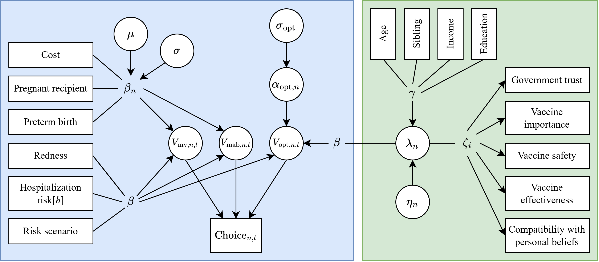

# HCM with random coefficients
## Path diagram

## Equations
$$
\text{Utility functions}\\
\begin{aligned}
V_{\mathrm{mv},n,t} =
&\ \sum_{h=1}^3 \Big[ \big(\beta_{\mathrm{hosp}[h]} + \beta_{\mathrm{hosp} \times \mathrm{risk}}x_{\mathrm{risk},n,t} \big) x_{\mathrm{hosp}[h],n,t} \Big]\ +\\
&\ \beta_{\mathrm{cost},n}x_{\mathrm{cost},n,t} + \beta_{\mathrm{redness}}x_{\mathrm{redness},n,t}\ +\\ 
&\ \beta_{\mathrm{preterm},n}^{\mathrm{mv}}x_{\mathrm{preterm},n,t} + \beta_{\mathrm{pregnant},n}^{\mathrm{mv}}x_{\mathrm{pregnant},n,t}\\
V_{\mathrm{mab},n,t} =
&\ \sum_{h=1}^3 \Big[ \big( \beta_{\mathrm{hosp}[h]} + \beta_{\mathrm{hosp} \times \mathrm{risk}}x_{\mathrm{risk},n,t} \big) x_{\mathrm{hosp}[h],n,t} \Big]\ +\\
&\ \beta_{\mathrm{cost},n}x_{\mathrm{cost},n,t} + \beta_{\mathrm{redness}}x_{\mathrm{redness},n,t}\\
V_{\mathrm{opt},n,t} =
&\ \beta_{\mathrm{opt} \times \mathrm{LV}}\lambda_n  + \beta_{\mathrm{opt} \times \mathrm{risk}}x_{\mathrm{risk},n,t} + \alpha_{\mathrm{opt},n}
\end{aligned}
$$

$$
\text{Random coefficients}\\
\beta_{\mathrm{cost},n}
\sim \mathrm{Normal}(\mu_{\mathrm{cost}}, \sigma_{\mathrm{cost}})\\
\beta_{\mathrm{preterm},n}^{\mathrm{mv}}
\sim \mathrm{Normal}(\mu_{\mathrm{preterm}}, \sigma_{\mathrm{preterm}})\\
\beta_{\mathrm{pregnant},n}^{\mathrm{mv}} 
\sim \mathrm{Normal}(\mu_{\mathrm{pregnant}}, \sigma_{\mathrm{pregnant}})\\
\alpha_{\mathrm{opt},n} 
\sim \mathrm{Normal}(0, \sigma_{\mathrm{opt}})
$$

$$
\text{Linear predictor for latent variable}\\
\lambda_n = 
\gamma_{\mathrm{age}}\tilde{z}_{\mathrm{age},n} +
\gamma_{\mathrm{sibling}}z_{\mathrm{sibling},n} +
\gamma_{\mathrm{education}}z_{\mathrm{education},n} +\\
\gamma_{\mathrm{income}}z_{\mathrm{income},n} + \eta_n,
\quad \eta_n \sim \mathrm{Normal}(0,1)
$$

$$
\text{Ordinal measurement component}\\
I_{i,n}^* = \zeta_i \lambda_n + \varepsilon_{i,n},
\quad \varepsilon_{i,n} \sim \mathrm{Logistic}(0,1)\\
I_{i,n} =
\begin{cases}
1 \quad \text{if } I_{i,n}^* \leq \tau_{i,1},\\
2 \quad \text{if } \tau_{i,1} < I_{i,n}^* \leq \tau_{i,2}\\
3 \quad \text{if } \tau_{i,2} < I_{i,n}^* \leq \tau_{i,3}\\
4 \quad \text{if } I_{i,n}^* > \tau_{i,3}
\end{cases}
$$

$$
\text{Likelihoods}\\
L_{C[n]}(\beta, \alpha, \lambda) = 
\prod_{t=1}^9 \frac{\exp(V_{j*,n,t})}{\sum_{j=1}^3 \exp(V_{j,n,t})}\\
L_{I[n]}(\tau, \zeta, \lambda) = 
\prod_{i=1}^5 P(I_{i,n} \mid \lambda_n)\\
\text{where } P(I_{i,n}=l \mid \lambda_n) = 
\mathrm{logit}^{-1}(\tau_{i,l}-\zeta_i\lambda_n) - \mathrm{logit}^{-1}(\tau_{i,l-1}-\zeta_i\lambda_n),\quad l = 1, \cdots, 4\\
LL(\Omega) = 
\sum_{n=1}^N \log \int L_{C[n]}(\beta, \alpha, \lambda) L_{I[n]}(\tau, \zeta, \lambda) f(\beta_n) g(\alpha_n) h(\eta_n) d\beta_n d\alpha_n d\eta_n
$$

## Legend
|Notation|Definition|
|--------|----------|
|$n$|Respondent index, $n \in \{1,\ \ldots,\ N\}$|
|$h$|Hospitalization index, $h \in \{1,\ \ldots,\ 3\}$|
|$i$|Indicator index, $i \in \{1,\ \ldots,\ 5\}$|
|$l$|Response level index, $l \in \{1,\ \ldots,\ 4\}$|
|$j$|Alternative index, $j \in \{1,\ \ldots,\ 3\}$|
|$j*$|Chosen alternative|
|$t$|Choice task index, $t \in \{1,\ \ldots,\ 9\}$|
|$\alpha_n$|Respondent-specific random intercept|
|$\beta$|Fixed coefficient for product attributes|
|$\beta_n$|Random coefficient for product attributes|
|$\varepsilon_{i,n}$|Indicator- & respondent-specific logistic error term|
|$\eta_n$|Random disturbance for linear predictor|
|$\gamma$|Coefficient for respondent characteristics|
|$\lambda_n$|Respondent-specific latent variable|
|$\Omega$|Vector of model parameters|
|$\tau_{i,l}$|Indicator & level-specific thresholds|
|$\zeta_i$|Indicator-specific factor loadings|
|$I_{i,n}$|Observed indicator- & respondent-specific response level|
|$I_{i,n}^*$|Latent continuous indicator- & respondent-specific response|
|$x_{n,t}$|Respondent & task-specific product attributes|
|$z_n$|Respondent-specific characteristics|
|$\tilde{z}_{\mathrm{age},n}$|Respondent-specific standardized age|
|$V_{j,n,t}$|Product, respondent & task-specific systematic utility|